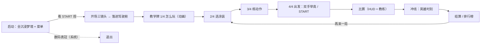

# Diva VR · 菜单与新手引导设计（Vision Pro）

按一份 visionOS 游戏 UX 评审提纲，对 Diva VR（分支 `carl/diva-vr`，2026-10-12 的版本）现有的菜单和新手引导做一次对照：哪里已经符合、哪里要改、哪里是引擎限制只能权衡。每条标了 **现状** / **建议** / **⚠ 需验证**（visionOS 每年都变，带 ⚠ 的要对照最新 HIG 和文档再定）。

## 1. 项目信息与假设

| 项目 | 内容（空白处是我的假设） |
| --- | --- |
| 标题 / 一句话 | Diva Safari VR：坐在机甲大象背上的驾驶舱里，第一人称开大象跑糖果小镇赛道，打靶、吃喝、放大招 |
| 类型 | 街机竞速 + 射击，单人，一局 1–3 分钟 |
| 引擎 | Unity 6000.6.3 + URP，`com.unity.xr.visionos` 3.3.1 的**全沉浸（Metal）**模式；不是 PolySpatial，所以没有 Shared Space 的窗口 / 体积可用 |
| 游戏所在空间 | Full Space 全沉浸；`-divaMixed` 能构建透视版（混合），目前不用 |
| 输入 | 仅手（XR Hands）。没有手柄；PS VR2 Sense 等空间配件 ⚠ 要查这版 Unity visionOS 包是否支持 |
| 姿势 | 坐（驾驶舱）；站着也能玩，但操纵杆的位置按坐姿定的（见 §6） |
| 移动 | 载具：大象动、驾驶舱不动，驾驶舱就是静止参照系 |
| 会话 / 受众 | 3–6 分钟一局；课堂同学和朋友，多数第一次戴 Vision Pro |
| 美术 | Eva 的粉彩糖果小镇 + 霓虹 + D.Va 风格 RGB 机舱 |
| 要学的机制（按优先级） | ① 看着按钮捏 ② 握杆前推 / 左右推 ③ 看着靶子捏（象鼻水炮） ④ 手放嘴边（吃喝补水） ⑤ 双手举到眼前（大招） ⑥ 道具、燃烧、黄金靶（被动，不用学） |
| 已有 UI 面 | 开场菜单（START、EN/中文）、选涂装、四步教学牌、HUD（分数 / 时间 / 任务 / 横幅）、教练提示、冲线英雄卡、结算 + 排行榜、再来一局 |
| 缺的 UI 面 | **暂停、设置、退出到菜单、重看教程**（现在只能靠系统的数码表冠退出） |

## 2. 空间与流程

现状（全部在 Full Space 里）：

- **现状**：一启动就是全沉浸。HIG 的做法是先在熟悉的窗口 / 体积里开始，玩家选择后再进深度沉浸。
- **引擎限制**：Unity 全沉浸管线没有 Shared Space 窗口；要"窗口先行"只有两条路：换 PolySpatial（整套渲染重做，不现实），或者用 `-divaMixed` 透视做"坐在自己房间里的菜单"，按 START 再切全沉浸。Carl 看过透视开场后明确要全沉浸（"泡泡梦幻"），所以这条列为权衡（§8），不是改动项。
- **建议（在全沉浸前提下补足 HIG 的意图）**：开场梦境保持"静止、低信息、无压力"，只有一块板、两个按钮（已是）；加一句"数码表冠随时退出"的常驻小提示（第一局）；比赛里加 **PAUSE**（§3）作为游戏内的出口。

## 3. 菜单系统

| UI 面 | 容器 / 放置 | 唤出 | 输入 | 悬停 / 按下反馈 | 层级 | 借鉴 | 说明 |
| --- | --- | --- | --- | --- | --- | --- | --- |
| 开场菜单 | 世界锁定的板（梦境里眼前 1.5 m） | 启动自动出现 | 看 + 捏（出现 1.5 s 后才响应） | 头朝向高亮（放大 8%、变亮）；按下缩一下 + confirm 音 | 1 | Moss 的"开书"：一个动作进入世界 | **现状**符合"重要菜单近、易找"。150 s 兜底自动开始只救手没追踪到的情况 |
| 选涂装 | 驾驶舱正前方的教学牌（车辆锁定） | 进舱后自动 | 看 + 捏按钮；随便捏一下 = 下一个 | 同上 + 全息大象弹一下、"LOCKED IN" 章 | 1 | 赛车游戏选车 | **现状**好。建议按钮再加 Spatial Audio 的方位提示音（捏到左右按钮声音从左右来） |
| 教学牌（怎么玩 / 练动作 / 出发） | 同一块牌，比赛时隐藏 | 流程自动 | 看 + 捏；练动作用真实手势 | 每个动作一条实时进度条 + NICE! 章 | 1 | Puzzling Places 可重看单节 | **建议**：加"重看某一段"的入口（§4） |
| HUD | 车辆锁定、前方 2 m 的透明层 | 比赛中常显 | 无 | — | — | 赛车 HUD | **现状**：不头锁、在视野中央 ✓ |
| 教练 | 世界里的柱子 + 箭头 + 眼前偏下的提示板 | 靠近任务点 / 卡住时 | 无 | — | — | Moss：用角色提示代替弹窗 | **现状**是升级式提示（环境 → 板）。**建议**第三级：卡住 10 s 再放一次发光的手 |
| 结算 | 教学牌（结算版） | 冲线后 | 看 + 捏 PLAY AGAIN，或双手举高 | 同按钮 | 1 | — | **建议**加"重看教程"按钮 |
| **暂停（新增）** | 仪表台上一颗实体按钮 → 弹出同款板 | 看着仪表台 PAUSE 捏 | 看 + 捏 | 同按钮；"回菜单"两步确认 | 2（板 → 确认） | Job Simulator：菜单是舱里的实物 | 板上：继续 / 重看教程 / EN 中文 / 回菜单。放在仪表台而不是手腕：手腕附近是系统手势区 |
| **设置（新增，放在暂停板里）** | 同暂停板第二页 | 暂停板里 | 看 + 捏 | — | 2 | Happy Beam：让玩家选输入方式 | 左手杆 / 右手杆；辅助模式（仪表台上的 DRINK、MEGA 按钮代替手势）；转弯暗角强度；音量 |

## 4. 新手引导（按阶段）

### 前 60 秒

| 步 | 教的技能 | 方法 | 成功条件 | 容易卡的点 → 兜底 | 重看 |
| --- | --- | --- | --- | --- | --- |
| 梦境菜单 | 看 + 捏（系统手势，玩家已会） | 板上 START 按钮 + "face a button and pinch" | 捏到 START | 20 s 没捏：START 开始呼吸式发光、提示音；手没追踪到：150 s 自动开始 | — |
| 开场三镜头 | 无（定向节拍：这是哪、要去哪） | 全景 + 任务信标 + "CANDY TOWN" | 自动 | 晕：只做直线慢推、暮色淡入淡出，不转世界 | — |
| 落进驾驶舱 | 无 | 泡泡"啪"一下落座 | 自动 | — | — |

### 前 10 分钟（第一局）

| 步 | 教的技能 | 方法 | 成功条件 | 容易卡的点 → 兜底 | 重看 |
| --- | --- | --- | --- | --- | --- |
| 1/4 怎么玩 | 六个动作的"长什么样" | 发光的幽灵手在你手该去的位置演示，游戏跟着反应（杆倾、水柱、爱心、泡泡），顶上一行字幕 | 看完（22 s）或 SKIP | 看不懂某一段：**建议**进度点可捏 = 重放那一段 | 结算板 / 暂停板"重看教程" |
| 2/4 选涂装 | 看 + 捏按钮；捏一下 = 下一个 | 三个按钮 + 全息大象 | 捏 CHOOSE | 捏不到按钮：捏任意处也会换涂装，玩家会发现"捏有反应" | — |
| 3/4 练动作 | 握杆推、左右推、看靶捏、手放嘴边 | 沙盒：每个动作一条实时进度条，做到就打勾；想练多久练多久 | 四个都打勾或 SKIP | 找不到杆：杆头发亮；4 s 没握住 → 杆挪到手边；**建议**8 s 没动静 → 幽灵手再演一次这一个动作 | 同上 |
| 4/4 出发 | 双手举到眼前（= 大招） | 板上示意 + 两只手的指示灯 + 按住进度条 | 举住 0.4 s 或捏 START | 举得太高 / 太低：指示灯只亮一边 → 提示"到眼睛高度" | — |
| 比赛 | 综合 | 教练：下一站柱子 + 箭头；靠近任务点弹动作提示；能量满弹大招提示；水少弹补水提示 | 冲线 | 一直不动：3.4 s 后"推杆前进"提示 + 卡片多留 12 s；**建议**10 s 还不动 → 幽灵手在真杆上再推一次 | — |
| 冲线 / 结算 | 无（奖励节拍） | 英雄时刻、奖牌、排行榜 | — | — | — |

### 第一小时（之后几局）

- 怎么玩 / 练动作每次启动只出一次，之后直接选涂装 → 出发（已是）。
- **建议**：结算板加"重看教程"；暂停板里也有。头显会话短而稀疏，回忆比第一次更重要。
- 进阶目标已经在了（奖牌时间线、燃烧、黄金靶、排行榜），让老手有事做。

## 5. visionOS 合规清单

| 项 | 状态 | 说明 |
| --- | --- | --- |
| 系统手势冲突 | ⚠ 要在真机测 | 大招是"双手举到眼前、掌心朝前"：掌心一旦转向自己就会弹出 Home 按钮。手放嘴边时掌心大概率朝脸 → 同样可能触发。对策：大招检测要求掌心朝前（现在没判朝向，建议加）；提示文案写"掌心朝前"；手放嘴边改成手背朝外的"拿东西吃"姿势演示。手腕翻转（控制中心）：杆只前推 / 侧推，不转手腕 ✓ |
| 60 pt 目标 + 悬停 | ✓ | 板上按钮最小 150 × 104 单位，在 1.45 m 处约 0.14 × 0.1 m（远大于 60 pt）；悬停放大 + 变亮，按下缩放 + 音效 |
| 直接 / 自定义手势都有间接替代 | ✗ | 握杆、手放嘴边、双手举高都是自定义手势，没有"看 + 捏"的替代。**建议**：辅助模式（仪表台 DRINK / MEGA 按钮；"巡航"开关 = 自动前进，只用杆转弯） |
| 视线隐私 | ✓ | 只在捏的瞬间拿到视线方向（`DivaVRFrame.look`），平时的高亮用头的朝向，不做凝视停留触发 |
| 舒适 | ✓ | 驾驶舱 = 静止参照系；从不转动可见世界；UI 世界 / 车辆锁定不头锁；转弯暗角；近处内容只有操纵杆和手。**建议**：暗角强度可调 |
| 退出沉浸 | 部分 | 只有系统表冠。**建议**加 PAUSE → 回菜单（两步确认） |
| 自定义手势要在 Full Space + 用户授权 | ⚠ | 第一次启动会弹手部追踪授权对话框，正好盖在梦境菜单上。要确认：授权期间 150 s 兜底不计时、菜单不会在玩家还没看到时就被跳过 |

## 6. 无障碍与舒适

- **坐 / 站**：驾驶舱按坐姿定（眼高 0.78 m 的相对布局），站着玩时膝旁的杆就在"腰下"。杆在倒数时会挪到 25 cm 内的手边，部分缓解；**建议**暂停板加"重新对位"（把杆和牌子按当前头的高度重摆）。
- **惯用手**：杆固定在右边。**建议**设置里加左手杆（镜像位置）。
- **够得着**：抓取半径 11 cm，推杆行程 3–12 cm，都在小动作范围；大招举手 0.4 s 不累。手放嘴边要求 19 cm 内，近脸但不贴脸。
- **动作替代**：§5 的辅助模式按钮；巡航开关。
- **文字**：板宽 1.1 m 在 1.45 m 处约 40° 视野，正文 46 单位 ≈ 1.6° 字高，够读；字幕条 38 单位勉强（≈1.3°）——**建议**字幕条正文不低于 42。
- **VoiceOver**：Unity 全沉浸里没有系统 VoiceOver / Direct Gesture ⚠（要查这版 Unity 包有没有无障碍桥接）。能做的是自配音：每一步教学和教练提示配语音（现在只有音效）。
- **晕动**：已遵守"不转世界、直线慢推、转弯暗角"；冲刺（大招 / 火箭）是直线加速，加速度短促，可接受；**建议**设置里能关冲刺的速度线特效。

## 7. 实现说明（Unity 全沉浸）

- **悬停**：Unity 全沉浸拿不到系统的凝视悬停效果，所以 `DivaVRGuide.HitButton` 用头的朝向算高亮——这是允许的"自定义悬停"，但别让它成为触发条件（现在只是高亮 ✓）。捏的那一刻视线由 `DivaVRInput` 给 `look`，优先于头朝向 ✓。
- **直接触摸**：操纵杆是"伸手到杆头"的直接交互（`DivaVRLever`，XR Hands 关节）。要加间接替代就是 §5 的辅助按钮。
- **系统手势**：Home / 控制中心不可屏蔽；真机上测试 §5 的两个姿势。
- **手部追踪授权**：ARKit 手部追踪只在 Full Space + 用户授权后可用；处理好第一次授权的时序（§5 最后一行）。
- **手柄 / 空间配件**：Unity Input System 的手柄能接（Game Controller 框架）；PS VR2 Sense 在 Unity 里的支持 ⚠ 查 `com.unity.xr.visionos` 的版本说明，这版 3.3.1 大概率没有。接了就要按输入类型换提示（现在提示全是手势）。
- **无障碍**：⚠ 查 Unity visionOS 包是否暴露 AccessibilityComponent 之类的桥；没有就只能自配音。
- **Look to Scroll** 等 visionOS 26 的系统交互只对系统视图有效，全沉浸里不适用。

## 8. 风险与权衡

| 权衡 | 取舍 |
| --- | --- |
| 沉浸 vs 可发现 | 操纵杆、仪表、PAUSE 按钮都做成舱里的实物（沉浸），代价是第一次要"找"：用发光、箭头、幽灵手补可发现性，而不是加文字 |
| 新手 vs 老手 | 怎么玩 / 练动作每次启动只出一次，老手 SKIP 两下；回忆靠"重看教程"按钮 |
| 手 vs 手柄 | 只做手；游戏就是为手设计的（杆、嘴、举手）。手柄要做也只做"辅助模式"那几个动作 |
| 一启动就全沉浸 vs HIG 的"窗口先行" | Unity 全沉浸没有窗口；透视开场被 Carl 否决。保留全沉浸，用"静止的梦境菜单 + 表冠退出提示 + PAUSE"把 HIG 的意图补回来 |
| 自定义手势 vs 系统手势区 | 大招和嘴边两个姿势都靠近系统手势的触发条件，真机不测就不能定 |

## 9. 测试计划

- **指标**（写进 `Documents/DivaPerf` 的日志就能拉）：第一次捏到 START 的时间；从进舱到第一次握住杆的时间；每一步教学的时长和 SKIP 率；卡住点（杆 10 s 没握、靶子 20 s 没打中、水空了 15 s 没补）；第一局圈速；一次会话玩几局；"重看教程"点击数。
- **方法**：5 个第一次戴 Vision Pro 的同学 + 2 个老手，每人一局，边玩边说；旁观者记"玩家第一次看向杆的时间"；玩完问三句：怎么前进、怎么补水、怎么放大招。
- **通过线**：新手 60 s 内按到 START、进舱 30 s 内握住杆、第一局 4 个任务完成 ≥ 2 个、没人因为 Home 按钮误弹而中断。

## 10. 如果时间只够做三件事

1. **PAUSE 按钮 + 暂停板**（继续 / 重看教程 / EN 中文 / 回菜单）：补上游戏内的出口和回忆入口，HIG 两条一起满足。
2. **辅助模式 + 左手杆**：仪表台上的 DRINK / MEGA 按钮和巡航开关，给够不着、不想举手、左撇子的人一条路；也是自定义手势的间接替代。
3. **大招 / 嘴边姿势避开系统手势**：大招加"掌心朝前"判定，嘴边改手背朝外；真机测一轮 Home 按钮会不会误弹。再顺手把前 60 秒的指标写进日志。
