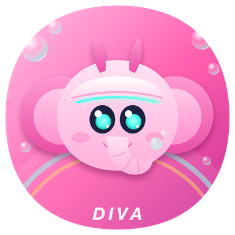

# Process

How Diva was made, in one place: the timeline, every release, every pull request, the branches and the app icon, with links to the process notes that already live elsewhere in the repository. Nothing in this folder is
needed to build or play the game. It was gathered from the git history, the pull requests and the releases on
2026-10-14; no existing file was moved or changed. Times are Pacific time.

## Timeline

| Day | Focus | What we did |
| --- | --- | --- |
| Oct 8 | Foundations | Set up the DigiPhant Unity project with the savannah course and the webcam, and got a first three-player gesture demo running. Wrote the game roadmap. Built Candy Town around the course: targets, a rocket, the HUD and a race intro under a starry sky. Put a D.Va-style mech suit on the elephant (#1), made the gestures drive the game (#2) and built the match flow: four skins, the ultimate, a highlight replay and a leaderboard (#3 to #5). 34 commits. |
| Oct 9 to 11 | Two ways to play | Started the first-person Apple Vision Pro version on its own branch, `carl/diva-vr`: a cockpit on the elephant's back, driven by hands and head (76 commits on that branch over the three days). Added keyboard play next to the gestures, synced the gesture controls in Unity and added trial export. |
| Oct 12 | Three players, one camera | Rebuilt three-player detection so all three bodies are found every frame without stalls. Thumbs-up refill, steering by tilting the shoulders or head, and the camera check page with role cards and a stick-figure demo. Candy, ON FIRE, golden targets, the log task, the finish arch and the ice wall. Then we locked the gesture settings for one and three players. 41 commits. |
| Oct 13 | Polish and release | A console-style look and a frame-rate guard for M1 and M2 Max MacBook Pros, and the app icon (below). v1.0 (#6), then v1.1 with downloads that run directly (#7, #8) and the product page (#9 to #13). Live testing led to v1.2 to v1.6: camera robustness, easier walking, a faster stop, fixed roles and role colours, Next camera on Windows (#14 to #20). The MediaPipe data was uploaded, and v2.0 made every player's controls reliable and put the controls under a password lock (#21). 72 commits. |

## Releases

| Version | Published | Platforms | What changed |
| --- | --- | --- | --- |
| [v1.1](https://github.com/EvaLuglitched/Diva/releases/tag/v1.1) | Oct 13, 12:20 | macOS, Windows, Vision Pro | The camera tracking is built into the desktop downloads (Windows needs no Python); full resolution with the camera on; a lighter opening blur |
| [v1.2](https://github.com/EvaLuglitched/Diva/releases/tag/v1.2) | Oct 13, 13:49 | macOS | Whoever stays in view keeps playing; no tracking crash with several people; the Mac uses its own camera; the tracking restarts by itself |
| [v1.3](https://github.com/EvaLuglitched/Diva/releases/tag/v1.3) | Oct 13, 14:31 | macOS, Windows | Easier walking for beginners; the camera tracking back to 30 fps |
| [v1.4](https://github.com/EvaLuglitched/Diva/releases/tag/v1.4) | Oct 13, 15:04 | macOS, Windows | The elephant stops on time; the booster effect is off; Next camera on Windows |
| [v1.5](https://github.com/EvaLuglitched/Diva/releases/tag/v1.5) | Oct 13, 16:33 | macOS, Windows | Single player tracks faster (about 22 instead of 15 frames a second); P2 keeps the steering; Mac and Windows on the same version |
| v1.6 | not published (draft) | macOS, Windows | Lifting one arm to aim no longer restarts walking; included in v2.0 |
| [v2.0](https://github.com/EvaLuglitched/Diva/releases/tag/v2.0) | Oct 13, 18:34 | macOS, Windows | Every player's controls work reliably; the controls are password-locked. Vision Pro stays on v1.1 |
| [MediaPipe data](https://github.com/EvaLuglitched/Diva/releases/tag/mediapipe-data-2026-10-13) | Oct 13, 17:20 | data | The pretrained models, the tracking code, P1 / P2 / P3 example photos and videos, gesture labels, recorded sessions and the process journal |

## Pull requests

| # | Merged | Branch | Title |
| --- | --- | --- | --- |
| [1](https://github.com/EvaLuglitched/Diva/pull/1) | Oct 8, 17:18 | `carl/eva-elephant-mech` | D.Va-style mech suit for the elephant |
| [2](https://github.com/EvaLuglitched/Diva/pull/2) | Oct 8, 19:13 | `carl/fix-gestures` | One playable scene, gestures drive the game, clearer setup errors |
| [3](https://github.com/EvaLuglitched/Diva/pull/3) | Oct 8, 20:51 | `carl/diva-show` | Match flow on the race intro: four skins, ultimate, highlight, leaderboard |
| [4](https://github.com/EvaLuglitched/Diva/pull/4) | Oct 8, 22:14 | `carl/diva-show-camera-sky` | Cameras avoid props, show the sky, recorder-safe timing |
| [5](https://github.com/EvaLuglitched/Diva/pull/5) | Oct 8, 22:28 | `carl/diva-show-eva-sync-fixes` | Match flow on the latest track |
| [6](https://github.com/EvaLuglitched/Diva/pull/6) | Oct 13, 11:03 | `carl/race-meta` | v1.0: race extras, ice wall, frame rate and look, course README, release builds |
| [7](https://github.com/EvaLuglitched/Diva/pull/7) | Oct 13, 12:15 | `carl/race-meta` | v1.1: downloads that run directly, full resolution with the camera, lighter opening blur |
| [8](https://github.com/EvaLuglitched/Diva/pull/8) | Oct 13, 12:20 | `carl/race-meta` | v1.1 follow-up: the Vision Pro zip carries Diva VR.app |
| [9](https://github.com/EvaLuglitched/Diva/pull/9) to [13](https://github.com/EvaLuglitched/Diva/pull/13) | Oct 13, 13:07 to 13:16 | `carl/race-meta` | The product page (`docs/index.html`) |
| [14](https://github.com/EvaLuglitched/Diva/pull/14) | Oct 13, 13:48 | `eva/camera-robustness` | Whoever stays in view keeps playing, no crash with several people |
| [15](https://github.com/EvaLuglitched/Diva/pull/15) | Oct 13, 14:05 | `eva/easier-walking` | Easier walking for beginners (approved locked-rule change) |
| [16](https://github.com/EvaLuglitched/Diva/pull/16) | Oct 13, 15:03 | `eva/faster-stop` | P1 stops on time; BOOSTER RUSH off |
| [17](https://github.com/EvaLuglitched/Diva/pull/17) | Oct 13, 16:47 | `carl/windows-v1.4` | Windows: Next camera, readable camera errors, 60 fps cap |
| [18](https://github.com/EvaLuglitched/Diva/pull/18) | Oct 13, 16:47 | `eva/fixed-roles` | Roles stay in each player's spot; role colours P1 red, P2 blue, P3 green |
| [19](https://github.com/EvaLuglitched/Diva/pull/19) | Oct 13, 16:47 | `carl/v1.5` | Single player tracks faster, P2 keeps the steering |
| [20](https://github.com/EvaLuglitched/Diva/pull/20) | Oct 13, 18:33 | `carl/v1.6` | Lifting one arm to aim no longer restarts walking |
| [21](https://github.com/EvaLuglitched/Diva/pull/21) | Oct 13, 18:33 | `eva/walk-hands-up` | v2.0: every player controls reliably, password lock |
| [22](https://github.com/EvaLuglitched/Diva/pull/22) | open | `eva/lock-docs` | Docs for the v2.0 lock on GitHub |

## Branches

**Active:** `main` (protected: changes come in through pull requests that pass the lock check), `carl/diva-vr` (the
Vision Pro version, still on v1.1), `carl/race-meta` (the PC work behind v1.0 and v1.1), and Eva's `eva/*` branches.

**Archived on Oct 14:** these branches were fully merged into `main`, so only their names were removed. Every commit
is still in `main`. To bring one back: `git push origin <commit>:refs/heads/<branch>`.

| Branch | Last commit | Pull request |
| --- | --- | --- |
| `carl/eva-elephant-mech` | `c763794b27548c6ec8923d80eef411a3f4282b3a` | #1 |
| `carl/fix-gestures` | `b0d6ac998ef6f24c8f54488f887b5acd810b4e3e` | #2 |
| `carl/diva-show` | `04625ee6b82a22ed426d1612bd5ac06057bc9adf` | #3 |
| `carl/diva-show-camera-sky` | `5b50a50bae318ced031bf02fb591d45f4434f944` | #4 |
| `carl/diva-show-eva-sync-fixes` | `99c55b077e35e998596bc9b834c946c4d92c3eab` | #5 |
| `carl/pc-three-player` | `e3538644149f7f440fc4750964f7e50b42d07f1b` | merged into `main` on Oct 12 |
| `carl/v1.6` | `43183df2b716a5ed293ad90dfbcadfbf41153562` | #20 |

## Process notes elsewhere in the repository

| File | What it records |
| --- | --- |
| [docs/ROADMAP.md](../docs/ROADMAP.md) | The plan for the game |
| [docs/EVA_UPDATES.md](../docs/EVA_UPDATES.md) | Eva's log of every update, with commit IDs |
| [docs/NOTE_FOR_EVA.md](../docs/NOTE_FOR_EVA.md), [docs/NOTE_FOR_VICKY.md](../docs/NOTE_FOR_VICKY.md) | Hand-over notes between us: what changed on shared files and why |
| [docs/PLAYTEST_TODO.md](../docs/PLAYTEST_TODO.md) | What still needs a test with real people |
| [GESTURES_LOCKED.md](../GESTURES_LOCKED.md) | The locked controls and every approved change to them |
| [DIGIPHANT_SETUP.md](../DIGIPHANT_SETUP.md) | The tested setup and the verification record |
| [Assets/eva大象/README.md](../Assets/eva%E5%A4%A7%E8%B1%A1/README.md) | How the mech suit is generated and fitted to the elephant |
| [docs/DIVA_VR_UX.md on `carl/diva-vr`](https://github.com/EvaLuglitched/Diva/blob/carl/diva-vr/docs/DIVA_VR_UX.md) | The Vision Pro menu and onboarding design |
| [Tools/perf_sim](../Tools/perf_sim) | The frame-rate guard checked on simulated loads |

## Media (kept outside git)

Recordings and large media stay out of the repository, as the course asks:

- **Recordings and the side-by-side video:** the [Drive folder](https://drive.google.com/drive/folders/1NAZGp2xYGU9ZVkIdl9RajQ89eXVgnDBF).
- **Gesture examples, recorded sessions and the process journal:** the [MediaPipe data release](https://github.com/EvaLuglitched/Diva/releases/tag/mediapipe-data-2026-10-13).
- **Screenshots of the finished game:** the product page, [docs/index.html](../docs/index.html), and `docs/img/`.

## App icon

The elephant icon used by every build: [`Assets/DivaShow/Icons/DivaIcon.png`](../Assets/DivaShow/Icons/DivaIcon.png),
sources in `Assets/DivaShow/Icons/Source~/`.

